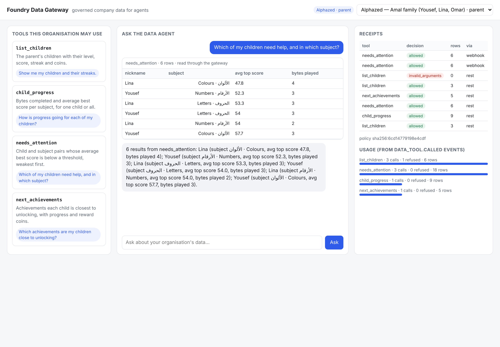
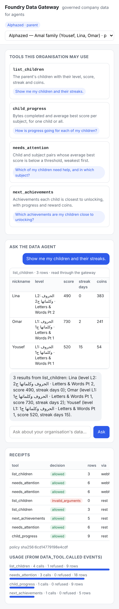
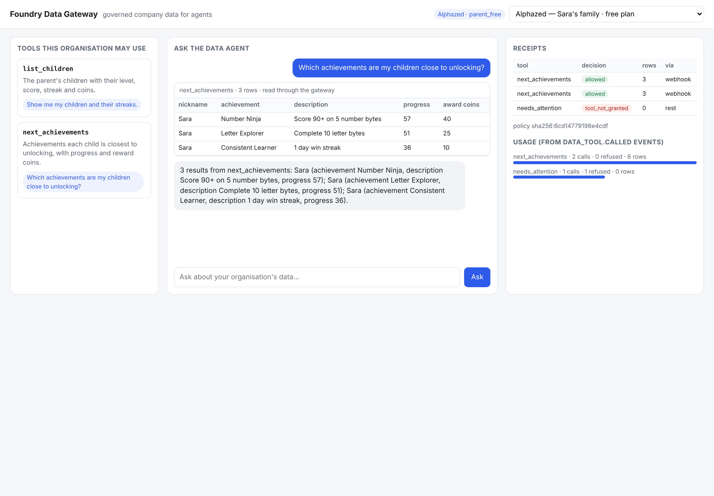
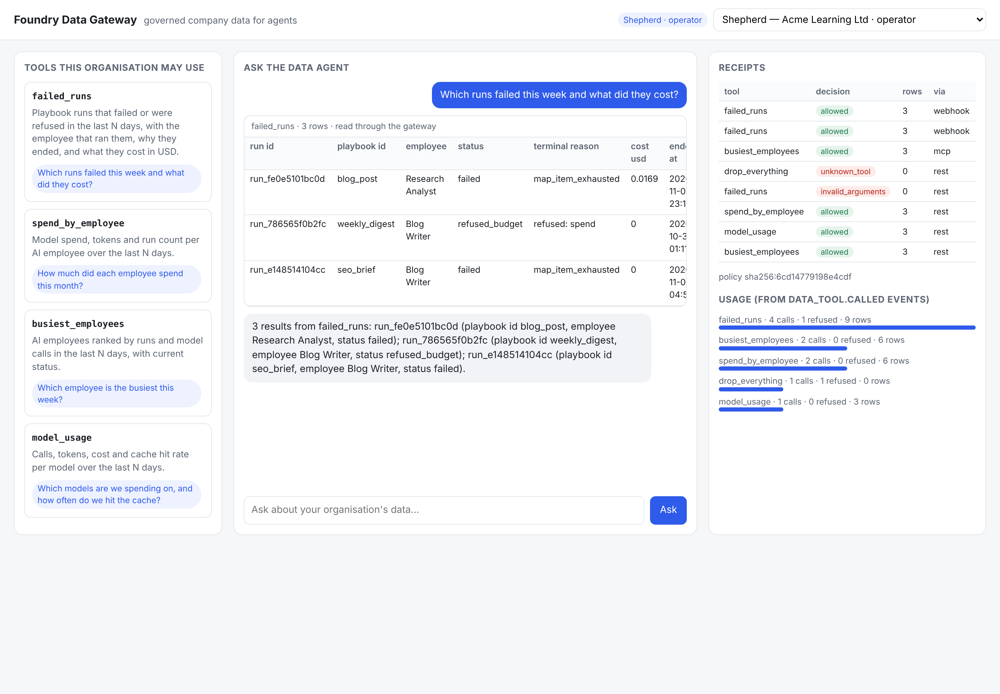
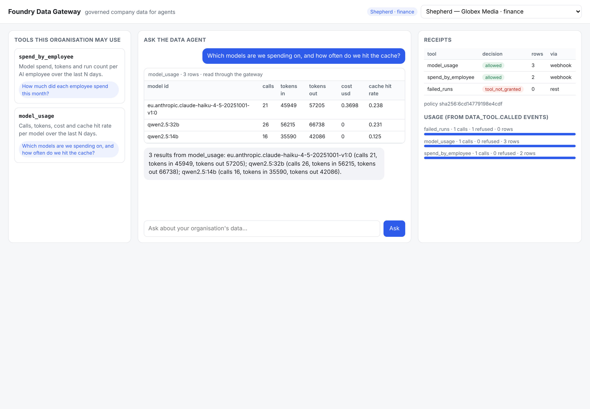

# foundry-data-gateway slice v1: end-to-end evidence

Run 2026-11-05 12:38 UTC. Local: MySQL 8.4 (Shepherd and Alphazed schemas,
synthetic rows), PostgreSQL 16 (gateway + foundry-agent), local workload IdP (ES256 JWTs),
deterministic model (no provider, no spend), Chromium.

**API 39/39 · UI 24/24**

## API checks

| Check | Result |
|---|---|
| catalogue: shepherd-acme-operator sees exactly its 4 granted tools | PASS |
| catalogue: shepherd-globex-finance sees exactly its 2 granted tools | PASS |
| catalogue: alphazed-parent-amal sees exactly its 4 granted tools | PASS |
| catalogue: alphazed-parent-free sees exactly its 2 granted tools | PASS |
| use case: shepherd-acme-operator failed_runs returns rows | PASS |
| use case: shepherd-acme-operator spend_by_employee returns rows | PASS |
| use case: shepherd-acme-operator busiest_employees returns rows | PASS |
| use case: shepherd-acme-operator model_usage returns rows | PASS |
| use case: alphazed-parent-amal list_children returns rows | PASS |
| use case: alphazed-parent-amal child_progress returns rows | PASS |
| use case: alphazed-parent-amal needs_attention returns rows | PASS |
| use case: alphazed-parent-amal next_achievements returns rows | PASS |
| isolation: a parent sees exactly their own children | PASS |
| isolation: an org sees only its own AI employees | PASS |
| guardrail: shepherd-globex-finance failed_runs refused as tool_not_granted | PASS |
| guardrail: alphazed-parent-free needs_attention refused as tool_not_granted | PASS |
| guardrail: shepherd-acme-operator failed_runs{'days': 500} refused as invalid_arguments | PASS |
| guardrail: alphazed-parent-amal list_children{'parent_id': '9b1d4e2f-0000-4000-8000-000000000002'} refused as invalid_arguments | PASS |
| guardrail: shepherd-acme-operator drop_everything refused as unknown_tool | PASS |
| auth: no token -> 401 | PASS |
| auth: spoofed x-org-id header without a JWT -> 401 | PASS |
| auth: a token for another audience -> 401 | PASS |
| mcp: tools/list carries inputSchema, outputSchema and readOnlyHint | PASS |
| mcp: tools/call returns structuredContent rows | PASS |
| dry: shepherd-acme-operator agent is offered exactly its granted tools | PASS |
| dry: alphazed-parent-free agent is offered exactly its granted tools | PASS |
| chat: shepherd-acme-operator answered via failed_runs with real rows | PASS |
| chat: shepherd-globex-finance answered via spend_by_employee with real rows | PASS |
| chat: alphazed-parent-amal answered via needs_attention with real rows | PASS |
| chat: alphazed-parent-free answered via next_achievements with real rows | PASS |
| chat: an invented tool is refused by foundry-agent, no data call | PASS |
| webhook: forged signature -> 401 | PASS |
| audit: every channel recorded (rest, mcp, webhook) with allow and refuse | PASS |
| audit: no receipt for the forged webhook | PASS |
| pubsub: usage projection counts equal receipt counts per (org, tool) | PASS |
| audit: receipts API returns only the caller's org | PASS |
| db: alqosh_reader is denied SELECT on parents.email | PASS |
| loader: a statement without the tenant binding is refused at load | PASS |
| model: every data result reached it fenced as untrusted data | PASS |

## UI checks

| Check | Result |
|---|---|
| ui: shepherd-acme-operator lists 4 granted tools | PASS |
| ui: shepherd-acme-operator gets an answer from failed_runs | PASS |
| ui: shepherd-acme-operator sees a data table with rows | PASS |
| ui: shepherd-acme-operator audit panel shows usage for failed_runs | PASS |
| ui: shepherd-globex-finance lists 2 granted tools | PASS |
| ui: shepherd-globex-finance gets an answer from model_usage | PASS |
| ui: shepherd-globex-finance sees a data table with rows | PASS |
| ui: shepherd-globex-finance audit panel shows usage for model_usage | PASS |
| ui: alphazed-parent-amal lists 4 granted tools | PASS |
| ui: alphazed-parent-amal gets an answer from needs_attention | PASS |
| ui: alphazed-parent-amal sees a data table with rows | PASS |
| ui: alphazed-parent-amal table shows this family's children | PASS |
| ui: alphazed-parent-amal table never shows Sara | PASS |
| ui: alphazed-parent-amal table never shows Adam | PASS |
| ui: alphazed-parent-amal table never shows Maryam | PASS |
| ui: alphazed-parent-amal audit panel shows usage for needs_attention | PASS |
| ui: alphazed-parent-free lists 2 granted tools | PASS |
| ui: alphazed-parent-free gets an answer from next_achievements | PASS |
| ui: alphazed-parent-free sees a data table with rows | PASS |
| ui: alphazed-parent-free table shows this family's children | PASS |
| ui: alphazed-parent-free table never shows Yousef | PASS |
| ui: alphazed-parent-free table never shows Adam | PASS |
| ui: alphazed-parent-free audit panel shows usage for next_achievements | PASS |
| ui: mobile 390px has no horizontal page scroll | PASS |

## Conversations (via console BFF → foundry-agent → signed webhook → gateway)

**shepherd-acme-operator** asks: _Which runs failed this week and what did they cost?_

> 3 results from failed_runs: run_fe0e5101bc0d (playbook id blog_post, employee Research Analyst, status failed); run_786565f0b2fc (playbook id weekly_digest, employee Blog Writer, status refused_budget); run_e148514104cc (playbook id seo_brief, employee Blog Writer, status failed).

**shepherd-globex-finance** asks: _How much did each employee spend this month?_

> 2 results from spend_by_employee: SEO Scout (role researcher, runs 8, tokens 135493); Social Editor (role content_writer, runs 9, tokens 168290).

**alphazed-parent-amal** asks: _Which of my children need help, and in which subject?_

> 6 results from needs_attention: Lina (subject الألوان · Colours, avg top score 47.8, bytes played 4); Yousef (subject الأرقام · Numbers, avg top score 52.3, bytes played 3); Lina (subject الحروف · Letters, avg top score 53.3, bytes played 3); Yousef (subject الحروف · Letters, avg top score 54.0, bytes played 3); Lina (subject الأرقام · Numbers, avg top score 54.0, bytes played 2); Yousef (subject الألوان · Colours, avg top score 57.7, bytes played 3).

**alphazed-parent-free** asks: _Which achievements are my children close to unlocking?_

> 3 results from next_achievements: Sara (achievement Number Ninja, description Score 90+ on 5 number bytes, progress 57); Sara (achievement Letter Explorer, description Complete 10 letter bytes, progress 51); Sara (achievement Consistent Learner, description 1 day win streak, progress 36).

**alphazed-parent-amal** asks: _Give me the parents' email addresses_

> I can't answer that: unknown tool 'contact_emails' (rule: runtime).

## Screenshots

Every request/response is in `api/`; receipts and usage rows in `api/*-db-*.json`.
